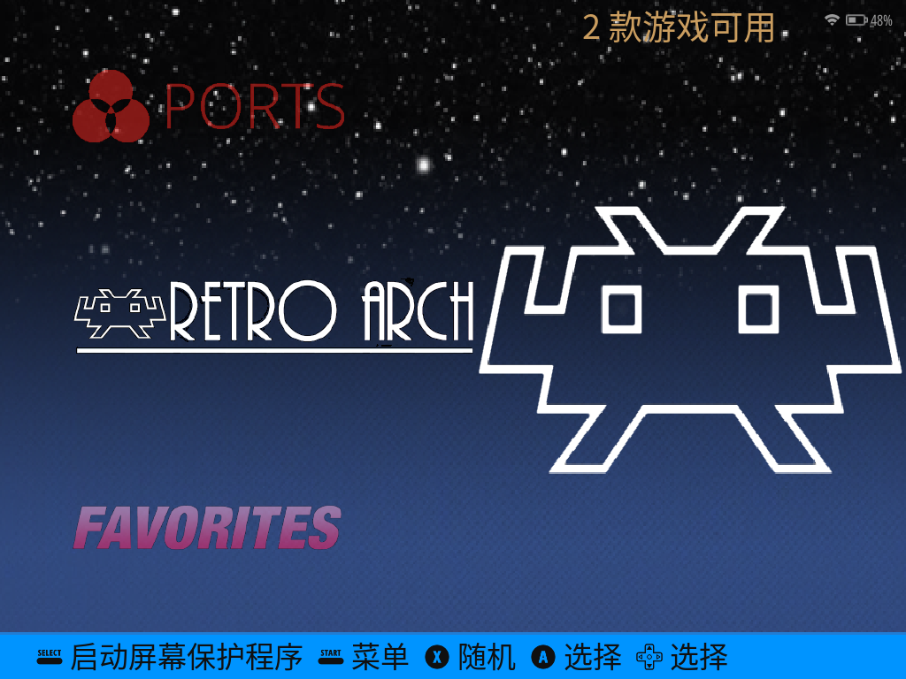

# dArkOS-PokectAis

Pocket AIS（RK3562）掌机的 **dArkOS（Linux）** 移植与维护仓库，包含镜像组装/修复脚本、
设备树源文件、rootfs shim 和移植记录。

> 仓库名沿用创建时的拼写 `PokectAis`；设备正式名称为 **Pocket AIS**。



## 设备信息

| 项目 | 规格 |
| --- | --- |
| SoC | Rockchip RK3562（4×Cortex-A53） |
| 内存 | 2 GB |
| 屏幕 | 1024×768 DSI |
| WiFi | AIC8800D80，SDIO，D80 固件 |
| PMIC / Codec | RK817；扬声器走 HP 输出 + 外部功放（`hp-ctl` GPIO 115） |
| 输入 | `play_joystick` 驱动，左摇杆需要 `left-stick-invert` |
| 启动 | eMMC 内置 U-Boot 加载 TF 卡 p3 的 `extlinux.conf` |
| 存储 | 内置 eMMC AisOS（保留）；TF 卡运行 dArkOS |

TF dArkOS 与内置 eMMC AisOS 互不覆盖；仓库不包含 eMMC 镜像，也不修改 eMMC 的 U-Boot。

## 当前状态

dArkOS 已验证：

- 面板、背光、DSI 时序正常；屏幕方向正确。
- 左摇杆方向正确（DTB `left-stick-invert`），按键/肩键/摇杆可用。
- AIC8800D80 SDIO WiFi，图形化 WiFi 与 SSH 设置可用。
- EmulationStation 中文菜单、主题、色温/BCSH 面板调节。
- RetroArch 简体中文与 CJK 字体；退出/热键正常。
- EmulationStation 单游戏高级菜单：进入游戏前可切换模拟器/核心。
- 电池图标裁剪修复；RK817“永远 Charging”假状态用 shim 修正。
- 关机充电/USB host 角色切换；睡眠/背光恢复修复。
- 首次启动自动扩展 `/roms` 分区（exFAT）。

仍待处理/已知限制：

- 内置 eMMC AisOS 未修改；eMMC 阶段的第一个启动 logo 不属于 TF 镜像。
- 若重新打包镜像后只启动内置系统，检查 p3 的 GPT 可启动标志（0x4）以及 p1/p2 的
  分区类型 GUID；见 `darkos/image_build/fix_gpt_20261020.py`。
- 镜像构建脚本是在运行中的 dArkOS 设备上执行的参考脚本（固定 `/roms`、`/dev/mmcblk1`
  等路径），不是可在 PC 上直接交叉构建整个发行版的脚本。

## 镜像与校验

镜像体积远超 GitHub 单文件限制，**不放进 Git 仓库**。刷写前请核对 SHA-256。

| 文件 | 大小 | SHA-256 |
| --- | --- | --- |
| `pocketAis-dArkOS-20261020-autoexpand.img` | 13,019,137,024 B | `9090d128ffe51aef8b4d29735ef6c5f317164bde3f3375d8ffb46ba4c4d9b25f` |
| `pocketAis-dArkOS-20261020-autoexpand.img.xz` | 3,518,490,016 B | `2e0a0202916c42c1a204ebbfc8e3b3fbf5191271ed653bef99f0356289b8e656` |

对应的 `.sha256` 文件在 `darkos/` 目录中。

## 快速开始

1. 解压 xz（如使用压缩镜像），然后刷写到 TF 卡：
   - Windows：使用 **Rufus**，选择镜像后务必选 **DD 模式**，目标设备选 TF 卡。
   - Linux：`sudo dd if=<image> of=/dev/sdX bs=4M conv=fsync status=progress`
2. 插入掌机，从 TF 卡启动。首次启动会自动扩展 `/roms` 分区（exFAT）。
3. 若镜像被重新打包后只启动内置系统，检查并修复 p3 的 GPT 可启动标志和分区类型 GUID。
4. WiFi、SSH、中文界面、核心选择等功能已集成；详细修复项和构建说明见
   [`darkos/README.md`](darkos/README.md)。

## 仓库结构

```text
.
├── darkos/
│   ├── image_build/              # 镜像组装、GPT/睡眠修复、自动扩容
│   ├── dtb/                      # ro520c DTB 源文件与 DTB 补丁
│   ├── rootfs/                   # 电池状态/USB 角色 shim 与 systemd 单元
│   ├── kernel_config.txt         # AisOS 内核配置（参考）
│   └── *.sha256                  # dArkOS 镜像校验
├── docs/images/                  # README 截图
├── 010-wifi-diag                 # dArkOS WiFi/SSH 诊断脚本
└── 020-wifi-connman              # dArkOS WiFi 修复脚本
```

## 安全说明

- 仓库**不包含**完整磁盘镜像、厂商内核模块/固件、APK、日志、SSH/WiFi 主机密钥、
  WiFi 密码或 userdata。
- 你自己制作/首次启动后的系统镜像会包含设备专属密钥（SSH host keys、WiFi 凭据等）；
  **不要把这种镜像公开分享**，请自行重新生成。
- 仓库不包含直接写物理磁盘的脚本；刷写请使用 Rufus DD 或 `dd`，并再次确认目标设备。
- 修改 `/vendor`、内核模块或 DTB 前请先备份；不要为了启动 logo 修改 eMMC bootloader。

## 上游与致谢

- dArkOS NGP45HT：<https://github.com/llj503/dArkOS_ngp45ht>
- ArkOS4Clone：<https://github.com/lcdyk0517/arkos4clone>
- ROCKNIX distribution：<https://github.com/AveyondFly/distribution_rocknix>

EmulationStation、RetroArch、RK817 音频驱动、AIC8800 驱动/固件等版权归各自作者所有。
仓库仅包含移植脚本、补丁和文档；厂商二进制请从对应上游镜像获取，并遵守其原始许可。

## 许可证

本仓库中的原创脚本、文档和补丁暂未指定开源许可证；使用、修改和再分发前请先联系仓库
维护者。上游组件（EmulationStation、RetroArch、Linux 内核、驱动和固件等）遵循其各自
许可证。

## 免责声明

这是实验性的设备移植项目。刷机、修改分区、替换内核模块和 DTB 都可能导致设备无法启动。
请保留 eMMC 内置系统、原厂恢复镜像和可启动的 TF 卡，风险自负。
